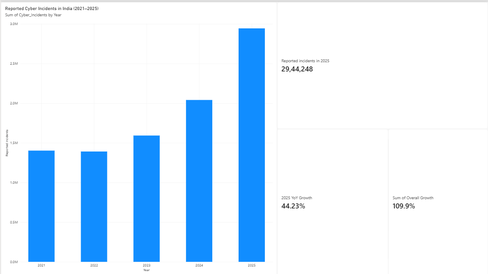

# 🇮🇳 India Digital Safety Report
### An Analysis of Reported Cyber Incidents in India (2021–2025)

## 📌 Project Overview
India's digital ecosystem is expanding rapidly, making cybersecurity an increasingly important concern.

This project analyzes reported cyber incidents in India between 2021 and 2025 to understand the trend, measure year-on-year changes, and highlight the importance of digital safety.

**Key question:** How has the number of reported cyber incidents in India changed over the last five years?

## 🎯 Objectives
- Analyze annual reported cyber incident figures.
- Calculate year-on-year growth.
- Measure overall growth between 2021 and 2025.
- Present key findings through an interactive Power BI dashboard.
- Identify practical digital safety recommendations.

## 🛠️ Tools Used
- Microsoft Excel – Data organization and calculations
- Microsoft Power BI – Data visualization and dashboard
- Git & GitHub – Project documentation and version control

## 📊 Key Findings

| Metric | Result |
|---|---:|
| Reported incidents in 2021 | 1,402,809 |
| Reported incidents in 2025 | 2,944,248 |
| Overall growth (2021–2025) | 109.9% |
| Year-on-year growth (2025) | 44.23% |

### Year-on-Year Growth

| Year | Growth |
|---|---:|
| 2022 | -0.81% |
| 2023 | 14.48% |
| 2024 | 28.15% |
| 2025 | 44.23% |

The data shows an overall increase in reported cyber incidents over the five-year period, with the highest annual growth occurring in 2025.

## 📈 Dashboard

The Power BI dashboard includes:
- Total reported incidents in 2025
- Overall growth since 2021
- Year-on-year growth in 2025
- Annual reported cyber incident trend (2021–2025)

## 🔐 Digital Safety Recommendations
- Enable multi-factor authentication.
- Use strong and unique passwords.
- Be cautious of phishing links and suspicious messages.
- Keep devices and software updated.
- Apply appropriate data access controls and encryption.
- Encourage timely reporting and response to cyber incidents.

## 📚 Data Source
**Primary source:** Ministry of Home Affairs, Government of India – parliamentary information on cyber incidents reported to CERT-In.

The figures used in this project:

| Year | Reported Cyber Incidents |
|---|---:|
| 2021 | 1,402,809 |
| 2022 | 1,391,457 |
| 2023 | 1,592,917 |
| 2024 | 2,041,360 |
| 2025 | 2,944,248 |

## 🧮 Methodology
Overall Growth:

`((2025 incidents - 2021 incidents) / 2021 incidents) × 100`

Year-on-Year Growth:

`((Current year incidents - Previous year incidents) / Previous year incidents) × 100`

## ⚠️ Important Limitations
- These figures represent reported cyber incidents, not confirmed personal data breaches.
- Incident counts do not indicate the number of affected individuals or records.
- The analysis identifies trends in reported incidents; it does not establish the causes of those changes.
- The findings should not be interpreted as a direct measurement of how safe or unsafe India's personal data is.

## 💡 Conclusion
Reported cyber incidents in India increased by approximately 109.9% between 2021 and 2025.

This trend highlights the growing importance of cybersecurity awareness, responsible data management, and stronger digital protection practices.

---

**Project Category:** Data Analytics | Cybersecurity | Digital Safety  
**Tools:** Excel | Power BI | GitHub